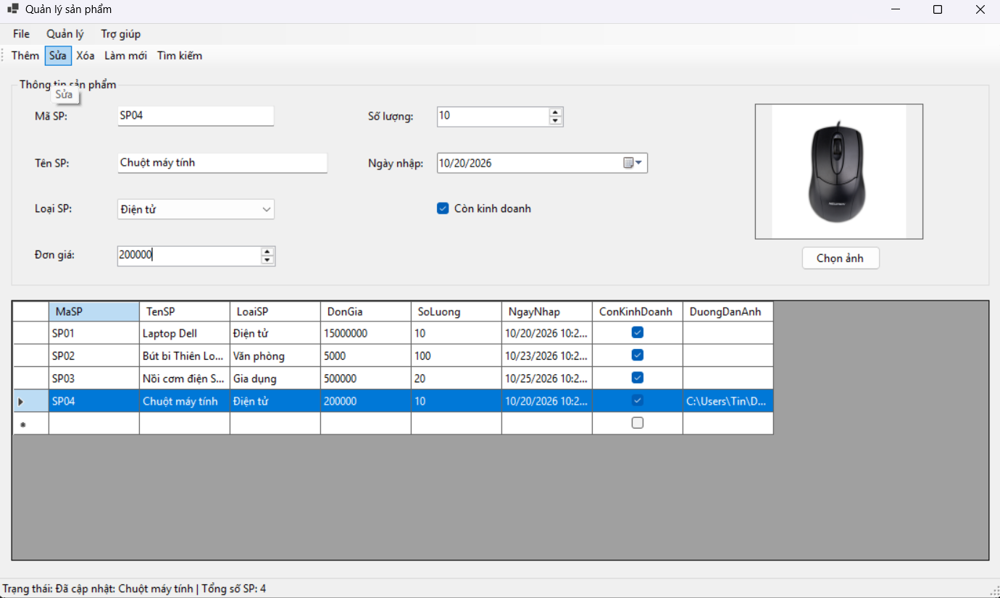
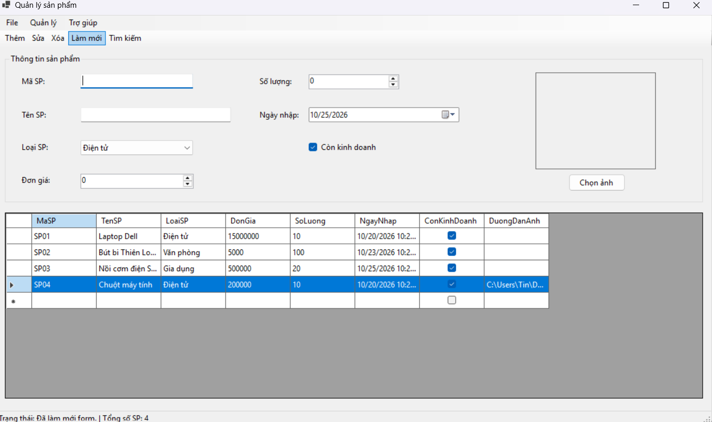
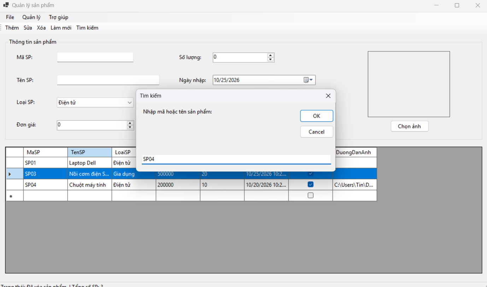
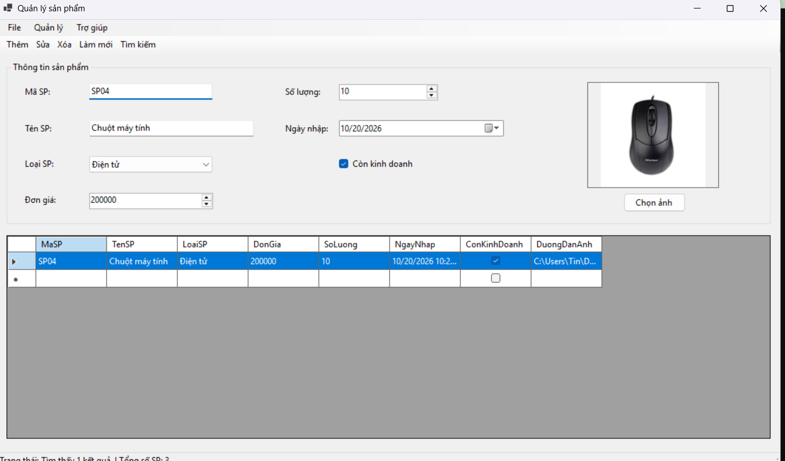
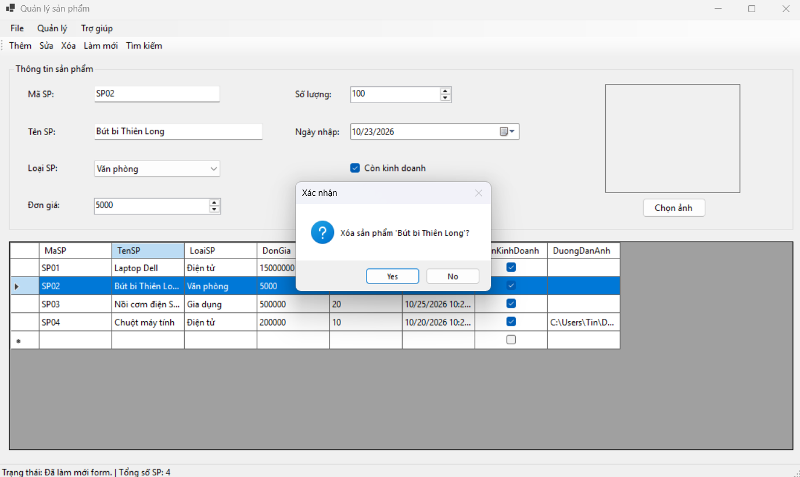

#  Báo cáo chức năng (Lab 05 - Product Manager)

Dự án này là một ứng dụng Windows Forms sử dụng C# nhằm quản lý danh sách sản phẩm. Ứng dụng áp dụng `BindingList<Product>` để quản lý dữ liệu trong bộ nhớ, kết hợp với các component nâng cao như `DataGridView`, `ErrorProvider`, `OpenFileDialog`, và `ToolStrip`.

Dưới đây là chi tiết các chức năng đã được triển khai thành công:

---

### 1. Chức năng Thêm mới sản phẩm (Create)

**Kịch bản sử dụng:**
*   **Nhập liệu:** Người dùng điền thông tin vào khu vực "Thông tin sản phẩm". Các control được sử dụng phù hợp với kiểu dữ liệu: `TextBox` (Mã, Tên), `ComboBox` (Loại SP), `NumericUpDown` (Số lượng, Đơn giá), `DateTimePicker` (Ngày nhập) và `CheckBox` (Trạng thái kinh doanh)[cite: 11].
*   **Thêm hình ảnh:** Nút **"Chọn ảnh"** gọi ra `OpenFileDialog` với bộ lọc chỉ cho phép chọn file ảnh (`.jpg`, `.png`...). Ảnh sau đó được hiển thị trực quan qua `PictureBox` với chế độ Zoom[cite: 11].
*   **Xử lý:** Khi nhấn **Thêm**, hệ thống chạy hàm `ValidateInput()` để đảm bảo không có trường nào rỗng, mã SP không bị trùng lặp và các giá trị số lớn hơn 0.
*   **Kết quả:** Sản phẩm `SP04` (Chuột máy tính) được đẩy vào danh sách. `DataGridView` tự động cập nhật thêm một dòng mới[cite: 11]. `StatusStrip` ở góc dưới cùng bên trái hiển thị dòng chữ: *"Trạng thái: Đã thêm: Chuột máy tính | Tổng số SP: 4"* nhằm thông báo thao tác thành công[cite: 11].

---

### 2. Chức năng Sửa thông tin sản phẩm (Update)

**Kịch bản sử dụng:**
*   **Binding dữ liệu ngược:** Khi người dùng click chọn dòng `SP04` trên `DataGridView`, sự kiện `SelectionChanged` sẽ tự động lấy dữ liệu từ dòng đó và đẩy ngược (load) lên các ô nhập liệu bên trên[cite: 12].
*   **Thao tác chỉnh sửa:** Người dùng tiến hành thay đổi thông tin mong muốn. Trong ví dụ này, **Đơn giá** của "Chuột máy tính" được điều chỉnh giảm từ `230000` xuống `200000`[cite: 12].
*   **Cập nhật:** Nhấn nút **Sửa** (hoặc chọn "Sửa" từ `ContextMenuStrip` khi click chuột phải). Hệ thống kiểm tra tính hợp lệ của dữ liệu, sau đó lưu đè dữ liệu mới vào object đang chọn[cite: 12].
*   **Kết quả:** Lưới `DataGridView` lập tức làm mới, phản ánh giá trị đơn giá mới là `200000`[cite: 12]. `StatusStrip` cập nhật trạng thái: *"Đã cập nhật: Chuột máy tính"* để xác nhận[cite: 12].

---

### 3. Chức năng Làm mới giao diện (Clear/Refresh)

**Kịch bản sử dụng:**
*   **Tình huống:** Sau khi thêm/sửa xong, hoặc khi đang nhập lỗi muốn hủy bỏ, người dùng nhấn nút **Làm mới** trên ToolStrip[cite: 13].
*   **Xử lý kỹ thuật:** Hàm `ClearInput()` được gọi. Tất cả các `TextBox` được xóa rỗng (Clear), `NumericUpDown` trả về `0`, `DateTimePicker` gán lại ngày hiện tại (Today), `PictureBox` bị gỡ ảnh (`Image = null`), và con trỏ chuột (Focus) được tự động đưa về ô nhập **Mã SP** để sẵn sàng cho một chu trình nhập liệu mới[cite: 13].
*   **Bỏ lọc:** Nếu danh sách đang trong trạng thái bị lọc bởi chức năng "Tìm kiếm", thao tác làm mới này cũng sẽ phục hồi toàn bộ dữ liệu ban đầu lên lưới[cite: 13].

---

### 4. Chức năng Tìm kiếm sản phẩm (Search - Nhập liệu)

**Kịch bản sử dụng:**
*   **Gọi tính năng:** Khi click vào nút **Tìm kiếm**, thay vì nhập trên Form, ứng dụng gọi ra một hộp thoại `InputBox` của thư viện Visual Basic để tương tác nhanh với người dùng[cite: 14].
*   **Thao tác:** Người dùng nhập từ khóa cần tìm kiếm (có thể là Mã hoặc Tên sản phẩm). Trong ảnh minh họa, từ khóa được nhập là `"SP04"`[cite: 14].

---

### 5. Chức năng Tìm kiếm sản phẩm (Search - Kết quả)

**Kịch bản sử dụng:**
*   **Xử lý kỹ thuật:** Sau khi nhận từ khóa `"SP04"`, hệ thống sử dụng công nghệ `LINQ` kết hợp `StringComparison.OrdinalIgnoreCase` để duyệt qua toàn bộ danh sách, lọc ra các sản phẩm có Mã hoặc Tên chứa từ khóa này (không phân biệt chữ hoa, chữ thường)[cite: 15].
*   **Kết quả hiển thị:** Nguồn dữ liệu của `DataGridView` được chuyển sang danh sách kết quả lọc. Lưới dữ liệu hiện tại chỉ còn hiển thị duy nhất bản ghi `SP04` thỏa mãn điều kiện[cite: 15]. Thông tin chi tiết của sản phẩm cũng được load tự động lên các control phía trên[cite: 15].

---

### 6. Chức năng Xóa sản phẩm an toàn (Delete)

**Kịch bản sử dụng:**
*   **Thao tác:** Người dùng chọn dòng dữ liệu của sản phẩm `SP02 - Bút bi Thiên Long` trên DataGridView và nhấn nút **Xóa**[cite: 16].
*   **Cơ chế an toàn (Safeguard):** Để tránh việc người dùng lỡ tay click nhầm dẫn đến mất dữ liệu, hệ thống lập tức hiển thị một hộp thoại cảnh báo `MessageBox` với câu hỏi xác nhận rõ ràng: *"Xóa sản phẩm 'Bút bi Thiên Long'?"* đi kèm các nút Yes/No[cite: 16].
*   **Kết quả:** Nếu người dùng chọn **Yes**, sản phẩm sẽ bị gỡ khỏi bộ nhớ (`BindingList`). Hệ thống tự động gọi hàm làm mới giao diện và cập nhật lại bộ đếm tổng số sản phẩm trên `StatusStrip`.