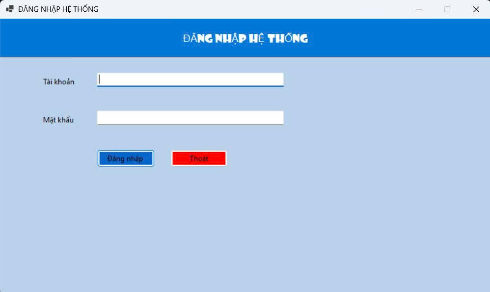
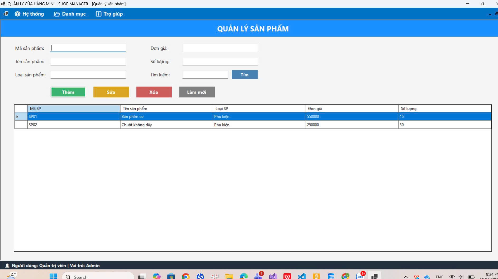
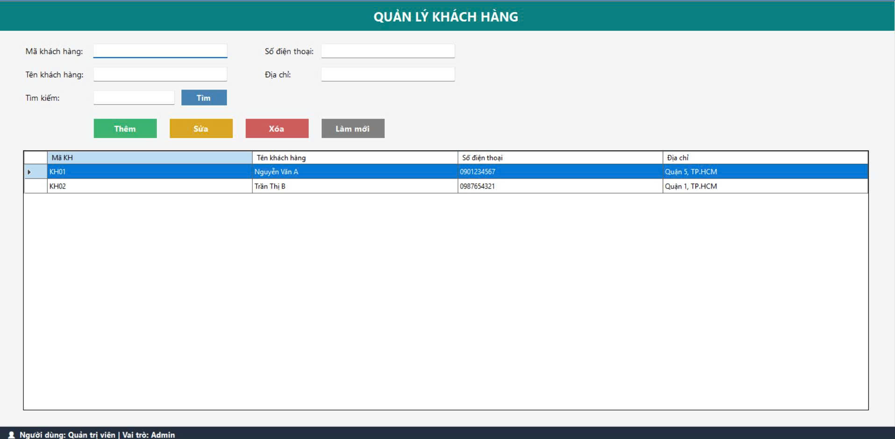
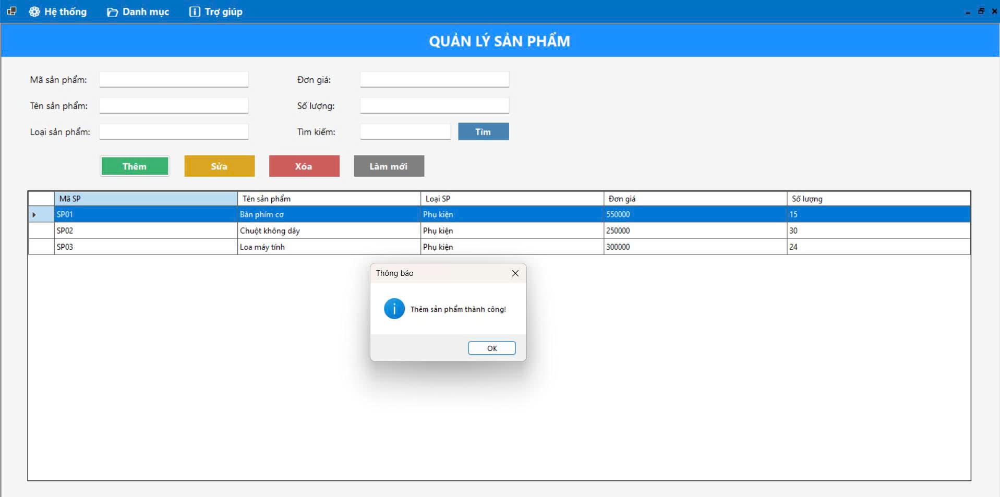
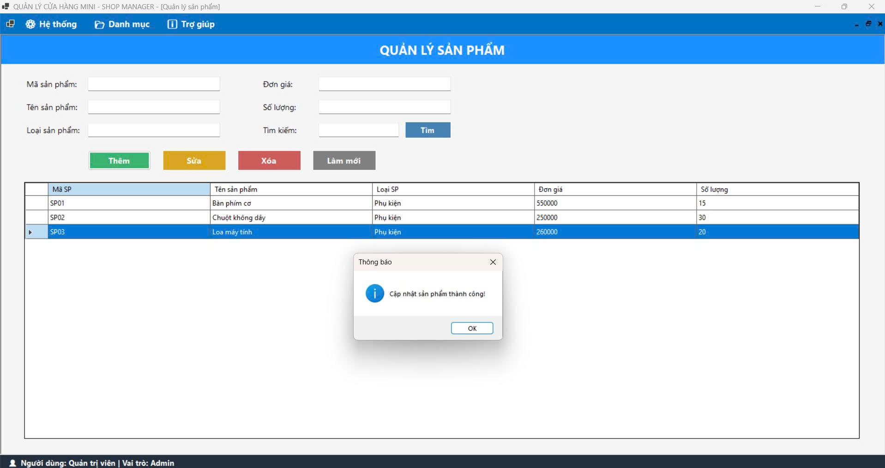
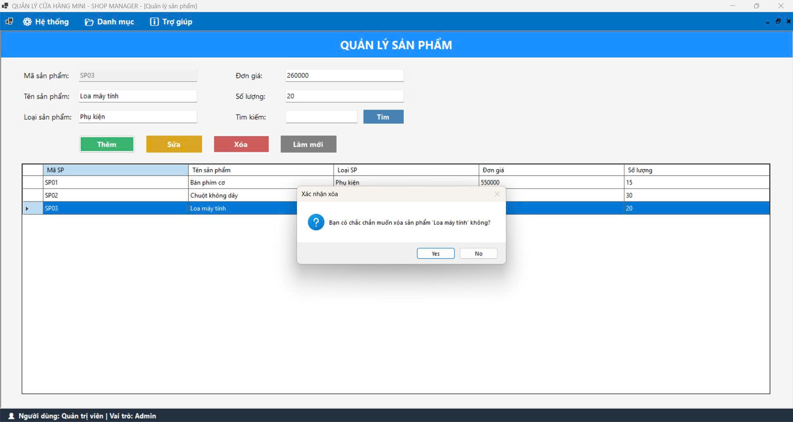
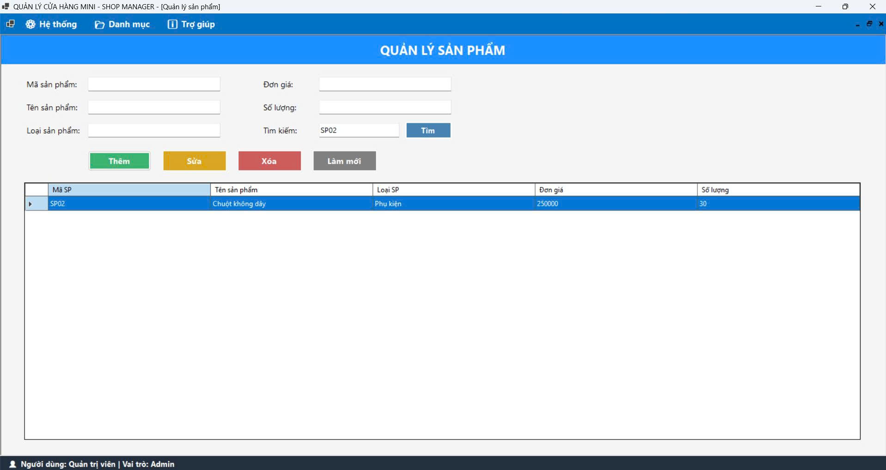
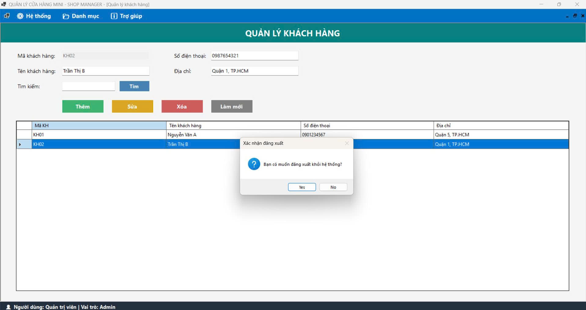
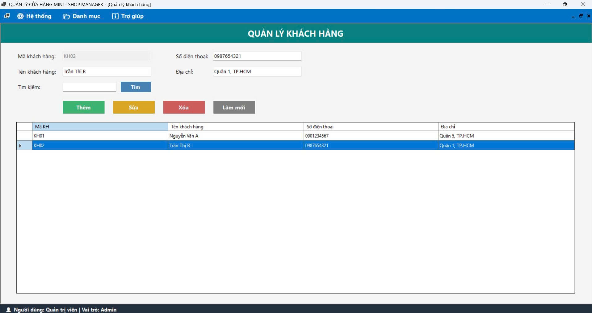
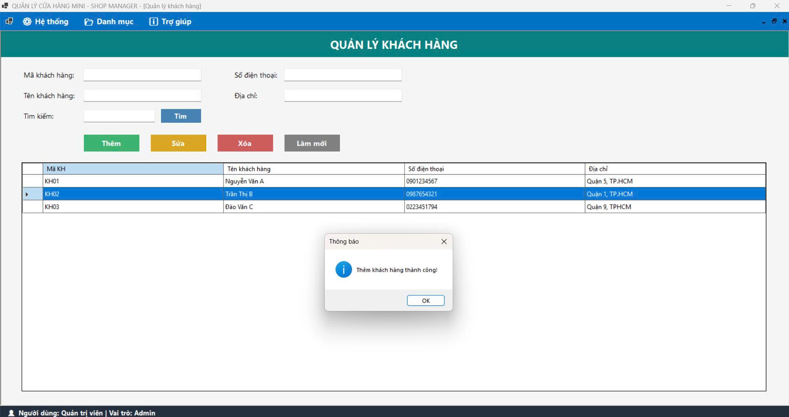

## 📷 Chi Tiết Giao Diện Hệ Thống

### 1. Giao diện Đăng nhập Hệ thống (`1.jpg`)

* **Bố cục:** Thiết kế tối giản với tông màu xanh dương chủ đạo, tiêu đề **"ĐĂNG NHẬP HỆ THỐNG"** nổi bật ở phần đầu trang[cite: 14].
* **Thành phần nhập liệu:** Bao gồm 2 ô `TextBox` để người dùng nhập **Tài khoản** và **Mật khẩu**[cite: 14].
* **Nút điều khiển:** 
  * Nút **Đăng nhập** (màu xanh dương) để xác thực thông tin truy cập vào phần mềm[cite: 14].
  * Nút **Thoát** (màu đỏ) để đóng ứng dụng ngay từ màn hình chờ[cite: 14].

---

### 2. Giao diện Quản lý Sản phẩm - Tổng quan (`2.jpg`)

* **Thanh điều hướng (MenuStrip):** Nằm ở trên cùng, chứa các danh mục chính: **Hệ thống**, **Danh mục**, và **Trợ giúp**[cite: 15].
* **Vùng nhập liệu & Tìm kiếm:** Cho phép xem và nhập các thông tin chi tiết của sản phẩm gồm: *Mã sản phẩm, Tên sản phẩm, Loại sản phẩm, Đơn giá, Số lượng* cùng với ô *Tìm kiếm* và nút **Tìm**[cite: 15].
* **Cụm nút chức năng (CRUD):** Được phân biệt trực quan bằng màu sắc: **Thêm** (Xanh lá), **Sửa** (Vàng cam), **Xóa** (Đỏ), và **Làm mới** (Xám)[cite: 15].
* **Bảng dữ liệu (`DataGridView`):** Hiển thị danh sách sản phẩm hiện có trong kho (ví dụ: `SP01 - Bàn phím cơ`, `SP02 - Chuột không dây`) với đầy đủ các cột thông tin tương ứng[cite: 15].
* **Thanh trạng thái (StatusStrip):** Nằm ở góc dưới cùng bên trái, hiển thị rõ thông tin phiên làm việc hiện tại: `Người dùng: Quản trị viên | Vai trò: Admin`[cite: 15].

---

### 3. Giao diện Quản lý Khách hàng - Tổng quan (`3.jpg`)

* **Thiết kế đồng bộ:** Sử dụng tông màu xanh cổ vịt (Teal) giúp người dùng dễ dàng phân biệt với phân hệ Quản lý sản phẩm nhưng vẫn giữ nguyên bố cục quen thuộc[cite: 15, 16].
* **Vùng thông tin khách hàng:** Bao gồm các trường dữ liệu: *Mã khách hàng, Tên khách hàng, Số điện thoại, Địa chỉ* và thanh công cụ *Tìm kiếm*[cite: 16].
* **Bảng danh sách khách hàng:** Liệt kê chi tiết thông tin các khách hàng đã lưu trữ trong hệ thống (ví dụ: `KH01 - Nguyễn Văn A`, `KH02 - Trần Thị B`)[cite: 16].

---

### 4. Thao tác Thêm mới Sản phẩm (`4.jpg`)

* **Trạng thái thực thi:** Minh họa kết quả sau khi người dùng nhập thông tin mặt hàng mới và nhấn nút **Thêm**[cite: 17].
* **Phản hồi hệ thống:** Xuất hiện hộp thoại thông báo (`MessageBox`) với biểu tượng chữ "i" (Information) xác nhận **"Thêm sản phẩm thành công!"**[cite: 17].
* **Cập nhật dữ liệu tự động:** Sản phẩm mới (`SP03 - Loa máy tính`, loại `Phụ kiện`, đơn giá `300000`, số lượng `24`) lập tức được thêm và hiển thị ngay dòng cuối cùng của bảng dữ liệu[cite: 17].

---

### 5. Thao tác Cập nhật (Sửa) Sản phẩm (`5.jpg`)

* **Trạng thái thực thi:** Minh họa quá trình chỉnh sửa thông tin của một mặt hàng đã có sẵn trong danh sách (sản phẩm `SP03 - Loa máy tính`)[cite: 18].
* **Kết quả thay đổi:** Sau khi điều chỉnh thông số và nhấn nút **Sửa**, dữ liệu của `SP03` trên bảng lập tức được cập nhật thành đơn giá mới (`260000`) và số lượng mới (`20`)[cite: 18].
* **Phản hồi hệ thống:** Hiển thị hộp thoại thông báo xác nhận **"Cập nhật sản phẩm thành công!"**[cite: 18].

---

### 6. Thao tác Xóa Sản phẩm & Cảnh báo bảo mật (`6.jpg`)

* **Cơ chế Binding dữ liệu:** Khi người dùng chọn dòng `SP03` trên bảng, toàn bộ thông tin của sản phẩm được tự động đổ ngược lên các ô `TextBox` phía trên (ô *Mã sản phẩm* `SP03` được làm mờ/khóa để không cho phép sửa khóa chính)[cite: 19].
* **Hộp thoại xác nhận:** Khi nhấn nút **Xóa**, hệ thống không xóa ngay mà bật hộp thoại **Xác nhận xóa** với câu hỏi: *"Bạn có chắc chắn muốn xóa sản phẩm 'Loa máy tính' không?"* kèm 2 lựa chọn **Yes / No**, giúp ngăn ngừa rủi ro xóa nhầm dữ liệu[cite: 19].

---

### 7. Chức năng Tìm kiếm Sản phẩm (`7.jpg`)

* **Thao tác tra cứu:** Người dùng nhập từ khóa hoặc mã sản phẩm cần tìm (ví dụ: `SP02`) vào ô **Tìm kiếm** và nhấn nút **Tìm**[cite: 20].
* **Kết quả lọc:** Bảng dữ liệu `DataGridView` lập tức được làm mới và chỉ hiển thị duy nhất bản ghi khớp với điều kiện tìm kiếm (`SP02 - Chuột không dây`), giúp việc tra cứu hàng hóa diễn ra nhanh chóng[cite: 20].

---

### 8. Xác nhận Đăng xuất khỏi Hệ thống (`8.jpg`)

* **Trạng thái thực thi:** Khi người dùng đang ở màn hình làm việc (ví dụ: Quản lý khách hàng) và thực hiện thao tác đăng xuất trên thanh menu Hệ thống[cite: 21].
* **Kiểm soát phiên làm việc:** Hệ thống hiển thị hộp thoại **Xác nhận đăng xuất** với nội dung *"Bạn có muốn đăng xuất khỏi hệ thống?"* (**Yes / No**) để đảm bảo người dùng không bị thoát phiên làm việc ngoài ý muốn[cite: 21].

---

### 9. Hiển thị Chi tiết Khách hàng (Data Binding) (`9.jpg`)

* **Tương tác giao diện:** Khi người dùng nhấp chuột chọn một dòng bất kỳ trên bảng danh sách khách hàng (ví dụ: dòng `KH02 - Trần Thị B`)[cite: 22].
* **Đồng bộ dữ liệu:** Dữ liệu từ dòng được chọn sẽ tự động hiển thị tương ứng lên các ô nhập liệu phía trên (*Mã khách hàng*: `KH02`, *Tên khách hàng*: `Trần Thị B`, *Số điện thoại*: `0987654321`, *Địa chỉ*: `Quận 1, TP.HCM`), sẵn sàng cho thao tác Sửa hoặc Xóa tiếp theo[cite: 22].

---

### 10. Thao tác Thêm mới Khách hàng (`10.jpg`)

* **Trạng thái thực thi:** Minh họa kết quả sau khi điền thông tin khách hàng mới và nhấn nút **Thêm** tại phân hệ Quản lý khách hàng[cite: 23].
* **Cập nhật & Thông báo:** Bản ghi mới (`KH03 - Đào Văn C`, SĐT `0223451794`, Địa chỉ `Quận 9, TPHCM`) được nạp trực tiếp vào cuối bảng dữ liệu, đồng thời hệ thống bật thông báo **"Thêm khách hàng thành công!"** và tự động làm trống các ô nhập liệu để chuẩn bị cho lượt nhập tiếp theo[cite: 23].
