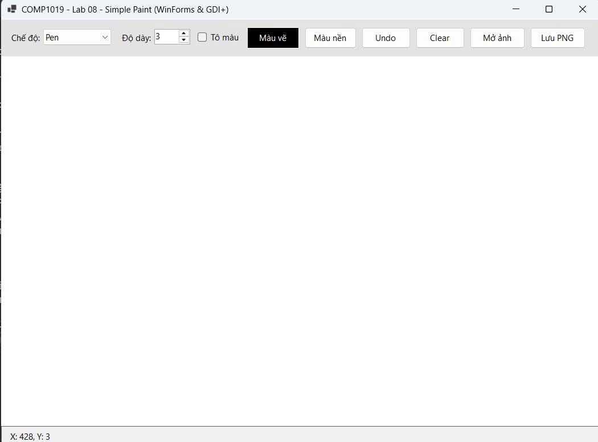
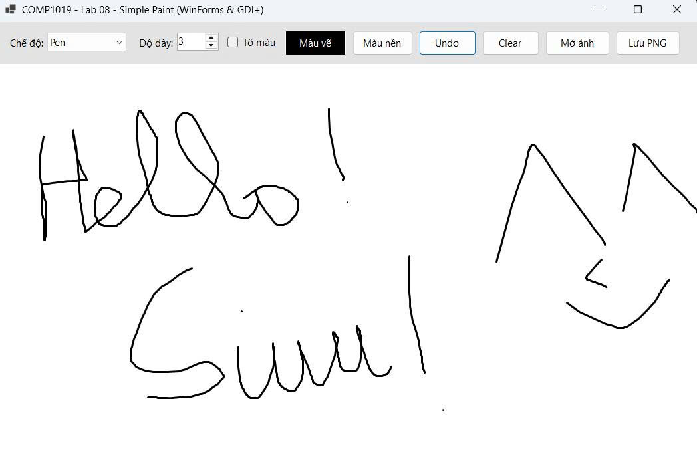
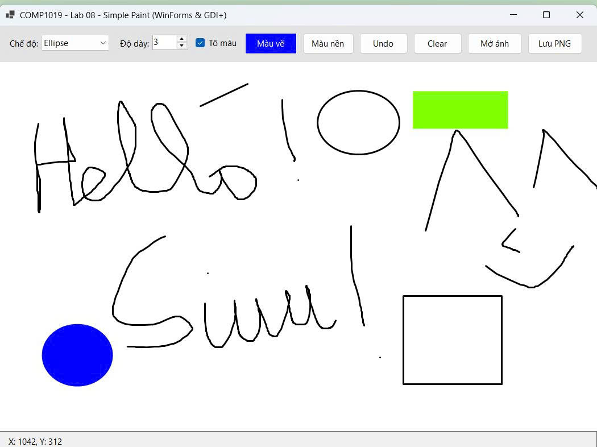
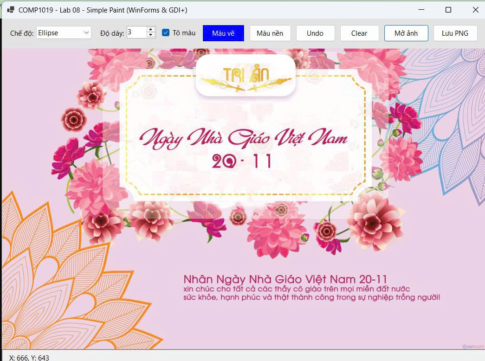

# COMP1019 - Lab 08: Ứng dụng Simple Paint (WinForms & GDI+)

Ứng dụng vẽ đồ họa 2D đơn giản được xây dựng bằng C# Windows Forms và GDI+. Chương trình lưu trữ danh sách đối tượng (`List<DrawItem>`) và xử lý vẽ trong sự kiện `Paint` trên Custom Panel (`DoubleBuffered`), đảm bảo hình vẽ mượt mà, không nhấp nháy và không bị mất khi thay đổi kích thước cửa sổ.

## 1. Mô tả giao diện
Giao diện ứng dụng được chia thành 3 khu vực chính:
* **Thanh công cụ (`pnlToolbar` - Phía trên):**
  * **Chế độ (`cboMode`):** Chọn công cụ vẽ (`Pen`, `Line`, `Rectangle`, `Ellipse`).
  * **Độ dày (`nudWidth`):** Điều chỉnh kích thước nét vẽ từ `1` đến `20`.
  * **Tô màu (`chkFill`):** Tùy chọn vẽ viền hoặc tô đặc màu cho Hình chữ nhật và Hình Elip.
  * **Màu vẽ (`btnColor`) & Màu nền (`btnBgColor`):** Mở hộp thoại `ColorDialog` để chọn màu nét vẽ và màu nền vùng vẽ.
  * **Thao tác (`btnUndo`, `btnClear`):** Hoàn tác nét vẽ gần nhất (hỗ trợ phím tắt `Ctrl + Z`) và xóa toàn bộ vùng vẽ.
  * **Tệp tin (`btnOpenImage`, `btnSave`):** Mở ảnh từ máy tính làm nền để vẽ đè lên và xuất bản vẽ ra file ảnh `.PNG`.
* **Vùng vẽ chính (`canvas` - Ở giữa):** Sử dụng `DoubleBufferedPanel` nền trắng, tự động co giãn theo kích thước Form.
* **Thanh trạng thái (`pnlStatus` - Phía dưới):** Hiển thị tọa độ con trỏ chuột `X, Y` theo thời gian thực trên vùng vẽ.

## 2. Hướng dẫn chạy chương trình
1. Mở file `.sln` bằng **Visual Studio 2022** trở lên.
2. Nhấn **F5** (hoặc nút **Start**) để biên dịch và chạy ứng dụng.

## 3. Hình ảnh kết quả chạy chương trình

**1. Giao diện tổng quan khi khởi động:**

**2. Vẽ tự do bằng chuột (Chế độ Pen):**

**3. Kết hợp vẽ 4 loại hình (Pen, Line, Rectangle, Ellipse) kèm tùy chỉnh màu sắc và tô đặc:**

**4. Chức năng nâng cao - Mở ảnh nền để vẽ đè lên ảnh:**
