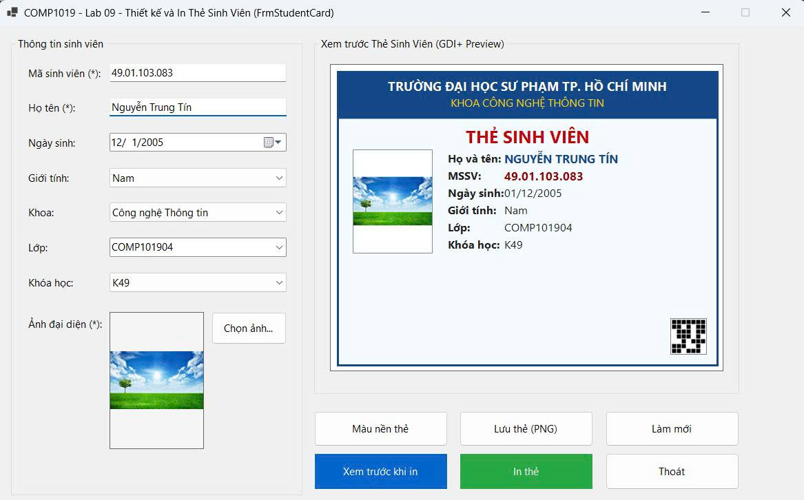
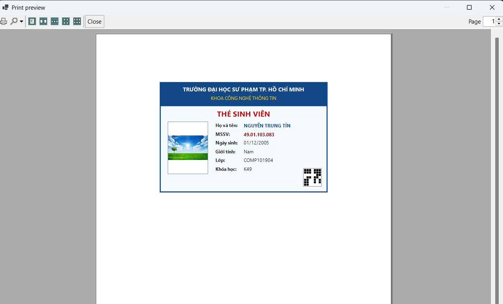

# COMP1019 - Lab 09: Thiết kế và In Thẻ Sinh Viên bằng WinForms

Ứng dụng Windows Forms hỗ trợ nhập thông tin sinh viên, chọn ảnh đại diện (giữ nguyên tỉ lệ, không khóa file), vẽ bản xem trước Thẻ Sinh Viên trực tiếp bằng GDI+ trên Panel và xuất bản in thông qua `PrintDocument` / `PrintPreviewDialog`.

## 1. Cấu trúc giao diện & Chức năng
* **Vùng nhập liệu (`grpInput` - Bên trái):**
  * Nhập Mã sinh viên, Họ và tên, Ngày sinh (`DateTimePicker`), Giới tính, Khoa, Lớp, Khóa học (`ComboBox`).
  * Chọn ảnh đại diện (`OpenFileDialog` lọc định dạng `JPG, JPEG, PNG, BMP`), hiển thị trên `PictureBox` ở chế độ `Zoom`.
* **Vùng xem trước thẻ (`grpPreview` - Bên phải):**
  * Tự động vẽ lại thẻ bằng GDI+ trong sự kiện `Paint` mỗi khi dữ liệu thay đổi.
  * Tích hợp tính năng mở rộng: Đổi màu nền thẻ, tạo mã QR giả lập theo MSSV và lưu thẻ thành file ảnh `.PNG`.
* **Chức năng in ấn & Kiểm tra dữ liệu:**
  * Kiểm tra ràng buộc (Validation) bắt buộc có Mã SV, Họ tên và Ảnh đại diện trước khi Xem trước hoặc In.
  * Xem trước bản in (`PrintPreviewDialog`) và chọn máy in (`PrintDialog`).

## 2. Hướng dẫn chạy chương trình
1. Mở file `Lab09.sln` bằng **Visual Studio 2022** trở lên.
2. Nhấn **F5** (hoặc nút **Start**) để biên dịch và chạy ứng dụng.

## 3. Danh sách 8 Test Case kiểm thử

| Mã TC | Tên kịch bản kiểm thử | Dữ liệu đầu vào / Thao tác | Kết quả mong đợi | Kết quả thực tế |
| :--- | :--- | :--- | :--- | :--- |
| **TC01** | Chọn ảnh đại diện hợp lệ | Nhấn `Chọn ảnh...`, chọn file ảnh `.jpg` hoặc `.png` | Ảnh hiển thị đúng tỉ lệ trên `PictureBox` và cập nhật ngay lên thẻ Preview GDI+ | **Pass** |
| **TC02** | Đổi ảnh đại diện liên tục | Chọn ảnh A, sau đó chọn tiếp ảnh B đè lên | Chương trình hiển thị ảnh B bình thường, không báo lỗi khóa file (File Lock) | **Pass** |
| **TC03** | Cập nhật Preview theo thời gian thực | Nhập Mã SV, Họ tên, đổi Khoa, Lớp, Ngày sinh | Vùng `pnlCardPreview` tự động vẽ lại thông tin mới ngay lập tức, không nhấp nháy | **Pass** |
| **TC04** | Kiểm tra lỗi để trống Mã sinh viên | Để trống ô Mã SV, nhấn `Xem trước khi in` hoặc `In thẻ` | Hiển thị `MessageBox` cảnh báo thiếu Mã sinh viên và đưa con trỏ về ô Mã SV | **Pass** |
| **TC05** | Kiểm tra lỗi để trống Họ tên | Nhập Mã SV, để trống Họ tên, nhấn `Xem trước khi in` | Hiển thị `MessageBox` cảnh báo thiếu Họ tên và không mở cửa sổ xem trước in | **Pass** |
| **TC06** | Kiểm tra lỗi chưa chọn Ảnh đại diện | Nhập đủ Mã SV và Họ tên nhưng không chọn ảnh, nhấn `In thẻ` | Hiển thị `MessageBox` yêu cầu chọn ảnh đại diện trước khi in | **Pass** |
| **TC07** | Xem trước bản in (`PrintPreviewDialog`) | Nhập đầy đủ Mã SV, Họ tên, chọn ảnh rồi nhấn `Xem trước khi in` | Cửa sổ `PrintPreviewDialog` hiện lên, hiển thị thẻ sinh viên rõ nét, ảnh không bị méo | **Pass** |
| **TC08** | Chức năng Làm mới (`Reset`) | Đang có dữ liệu và ảnh, nhấn nút `Làm mới` | Xóa trắng Mã SV, Họ tên, xóa ảnh đại diện và đưa thẻ Preview về trạng thái mặc định | **Pass** |

## 4. Hình ảnh kết quả chạy chương trình

**1. Giao diện Form chính và Preview thẻ bằng GDI+:**

**2. Giao diện Xem trước khi in (PrintPreviewDialog):**
