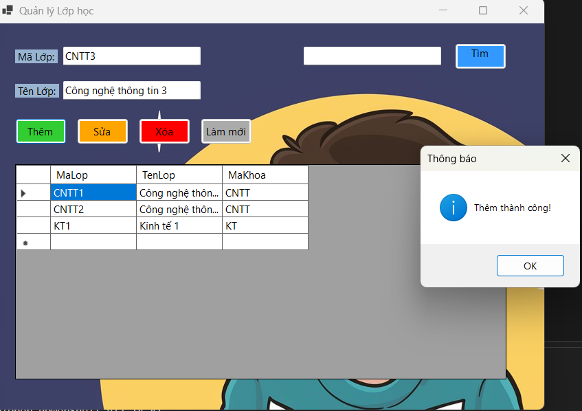
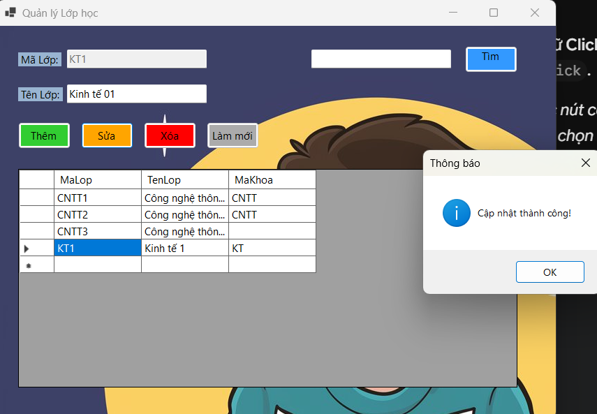
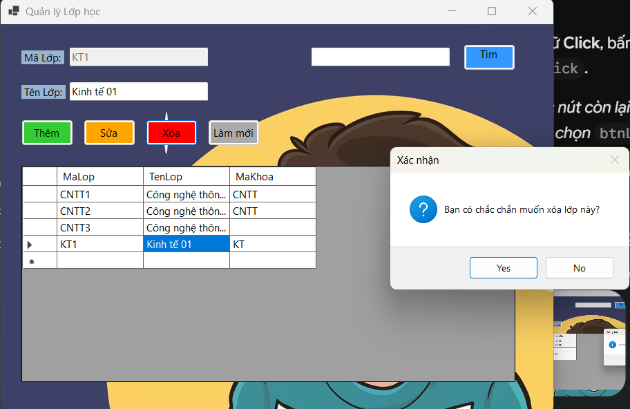
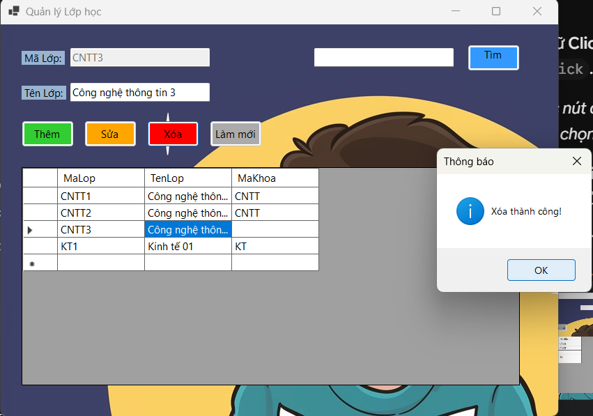
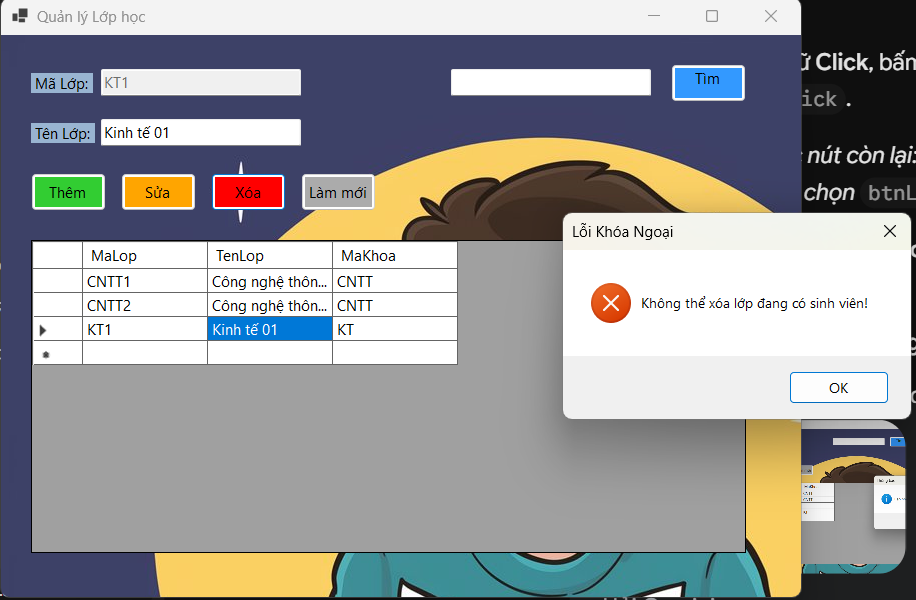
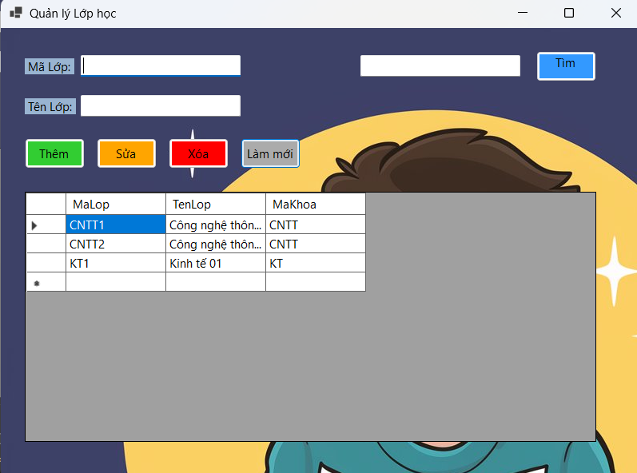
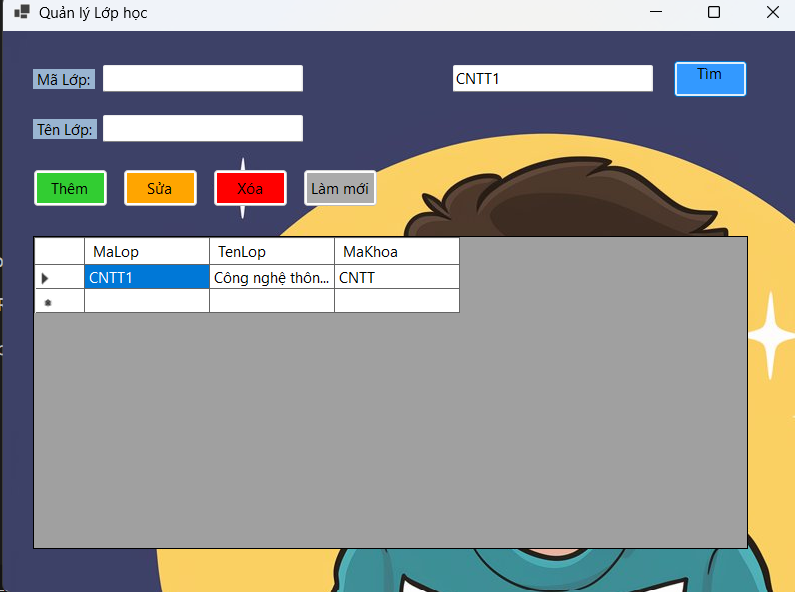

 Chức năng Giao diện Quản lý Lớp học (Lab 11)

Giao diện Quản lý Lớp học được xây dựng nhằm cung cấp các công cụ trực quan để người dùng tương tác với bảng dữ liệu Lớp học trong cơ sở dữ liệu. Ứng dụng đảm bảo đầy đủ các thao tác CRUD (Create, Read, Update, Delete) kết hợp với các cơ chế kiểm tra ràng buộc và xử lý ngoại lệ (Try-Catch) để đảm bảo tính toàn vẹn dữ liệu.

### 1. Chức năng Thêm mới (Create)
- **Luồng hoạt động:** Người dùng nhập thông tin chi tiết vào các trường `Mã Lớp` và `Tên Lớp`. Khi nhấn nút **Thêm**, hệ thống sẽ thu thập dữ liệu từ các TextBox và thực thi câu lệnh `INSERT` vào cơ sở dữ liệu.
- **Kết quả:** Sau khi thêm dữ liệu thành công, hệ thống hiển thị hộp thoại thông báo "Thêm thành công!" và ngay lập tức tải lại (refresh) DataGridView để hiển thị bản ghi vừa được thêm[cite: 1].

### 2. Chức năng Cập nhật (Update)
- **Luồng hoạt động:** Tính năng này hỗ trợ Binding dữ liệu trực quan. Khi người dùng click chọn một dòng bất kỳ trên DataGridView, thông tin của dòng đó sẽ tự động được đẩy ngược lên các TextBox tương ứng.
- **Kết quả:** Người dùng tiến hành chỉnh sửa nội dung (ví dụ: Tên Lớp) và nhấn nút **Sửa**. Hệ thống gọi lệnh `UPDATE` dựa trên khóa chính (`Mã Lớp`). Khi hoàn tất, hộp thoại "Cập nhật thành công!" xuất hiện và DataGridView phản ánh ngay dữ liệu mới[cite: 2].

### 3. Chức năng Xóa (Delete) & Quản lý Ràng buộc Toàn vẹn (Foreign Key Constraint)
Đây là chức năng được thiết kế với hai lớp bảo vệ dữ liệu nghiêm ngặt:
- **Lớp bảo vệ 1 (UX/UI):** Khi nhấn nút **Xóa**, thay vì thực thi ngay, hệ thống hiển thị một `MessageBox` xác nhận ("Bạn có chắc chắn muốn xóa lớp này?") với hai lựa chọn Yes/No, giúp ngăn chặn thao tác click nhầm[cite: 3].

- **Lớp bảo vệ 2 (Database Constraint):** 
  - Nếu bản ghi độc lập (không có dữ liệu liên quan), thao tác xóa diễn ra bình thường và báo "Xóa thành công!"[cite: 4].
  
  - **Xử lý ngoại lệ (Exception Handling):** Nếu Lớp học đang được tham chiếu bởi bảng Sinh viên (có sinh viên thuộc lớp này), cơ sở dữ liệu sẽ báo lỗi vi phạm khóa ngoại. Thay vì để ứng dụng crash, khối lệnh `Try-Catch` sẽ bắt lỗi này và thông báo rõ ràng cho người dùng: "Không thể xóa lớp đang có sinh viên!", đảm bảo hệ thống luôn hoạt động ổn định[cite: 5].
  

### 4. Chức năng Làm mới (Reset/Clear)
- **Luồng hoạt động:** Nút **Làm mới** đóng vai trò hỗ trợ UX, giúp người dùng thao tác nhanh hơn. Khi được nhấn, nó sẽ xóa trắng toàn bộ dữ liệu đang có trên các ô TextBox nhập liệu.
- **Kết quả:** Đưa form về trạng thái trống ban đầu, giải phóng các focus cũ, sẵn sàng cho việc nhập một bản ghi hoàn toàn mới mà không yêu cầu người dùng phải xóa thủ công từng ô[cite: 6].

### 5. Chức năng Tìm kiếm (Search/Filter)
- **Luồng hoạt động:** Chức năng tìm kiếm cho phép truy xuất dữ liệu nhanh chóng trong trường hợp danh sách lớp học dài. Người dùng nhập từ khóa (ví dụ: mã lớp "CNTT1") vào ô tìm kiếm và nhấn nút **Tìm**.
- **Kết quả:** Hệ thống thực thi truy vấn (sử dụng mệnh đề `WHERE` hoặc LINQ filter) và lọc lại danh sách, chỉ hiển thị lên DataGridView những bản ghi khớp với điều kiện tìm kiếm[cite: 7].
