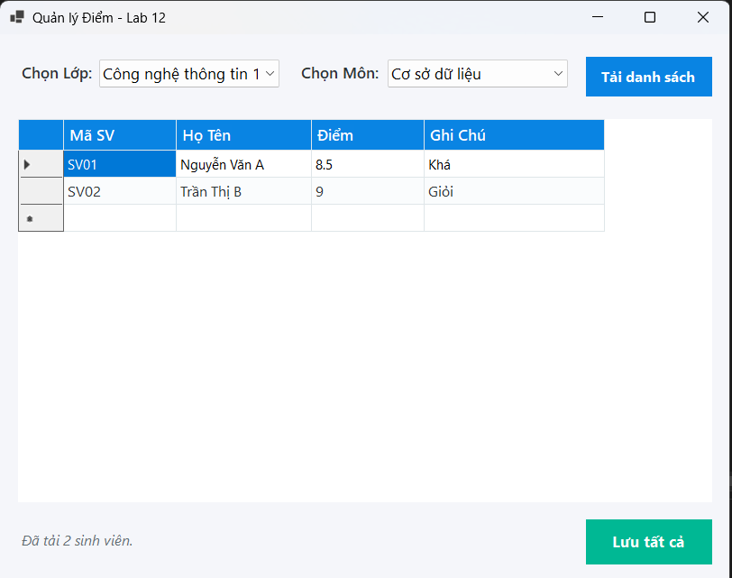
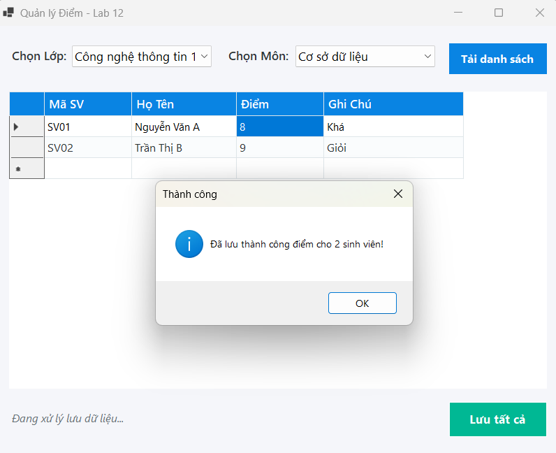
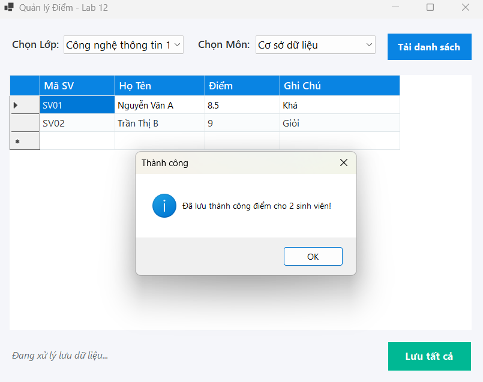

## Chức năng giao diện Quản lý Điểm (Lab 12)

Giao diện Quản lý Điểm được thiết kế để thực hiện việc Data Binding từ cơ sở dữ liệu lên các điều khiển trực quan và xử lý cập nhật nhiều dòng dữ liệu cùng lúc thông qua Stored Procedure và Transaction, đảm bảo tính an toàn và toàn vẹn dữ liệu mức tối đa.

### 1. Chức năng Data Binding và Tải danh sách
Khi khởi động, hệ thống tự động tải và liên kết (Binding) dữ liệu Lớp và Môn học vào các ComboBox. Người dùng tiến hành chọn lớp, chọn môn và nhấn nút **Tải danh sách**. Hệ thống sẽ gọi Stored Procedure để lấy danh sách sinh viên tương ứng và hiển thị lên DataGridView. Tại đây, các cột "Mã SV" và "Họ Tên" được khóa ở chế độ chỉ đọc để tránh sửa nhầm, đồng thời thanh trạng thái bên dưới cập nhật số lượng sinh viên vừa tải[cite: 18].

### 2. Chức năng Nhập điểm và Kiểm tra tính hợp lệ (Validation)
Người dùng có thể nhập hoặc chỉnh sửa trực tiếp trên cột "Điểm" và "Ghi Chú". Hệ thống được tích hợp sẵn cơ chế kiểm tra (CellValidating) nghiêm ngặt ngay trên giao diện: điểm nhập vào bắt buộc phải là số và phải nằm trong giới hạn từ 0 đến 10. Nếu nhập sai định dạng (ví dụ: nhập chữ cái hoặc số âm), hệ thống sẽ ngay lập tức chặn lại và yêu cầu nhập đúng trước khi cho phép thực hiện thao tác khác.

### 3. Chức năng Lưu dữ liệu hàng loạt với Transaction (Upsert)
Sau khi hoàn tất quá trình nhập điểm, người dùng nhấn nút **Lưu tất cả**. Ứng dụng sẽ duyệt qua danh sách và sử dụng `SqlTransaction` để gói toàn bộ thao tác lưu lại. Hệ thống áp dụng cơ chế Upsert (nếu sinh viên đã có điểm thì Cập nhật, nếu chưa có thì Thêm mới). 
- **Thành công (Commit):** Nếu tất cả các dòng đều hợp lệ, dữ liệu được ghi nhận vào cơ sở dữ liệu, hộp thoại thông báo lưu thành công xuất hiện[cite: 19].

- **Thất bại (Rollback):** Nếu có bất kỳ một lỗi nhỏ nào xảy ra trong quá trình lưu (lỗi kết nối, lỗi ràng buộc CSDL), khối Try-Catch sẽ bắt lỗi và gọi lệnh Rollback để hoàn tác toàn bộ, đảm bảo cơ sở dữ liệu không bao giờ rơi vào trạng thái cập nhật dang dở.