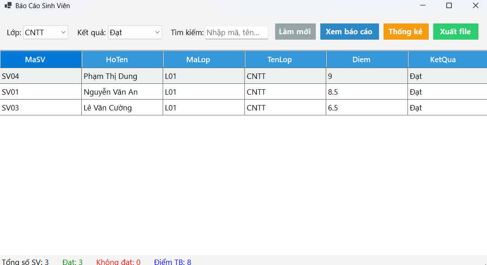
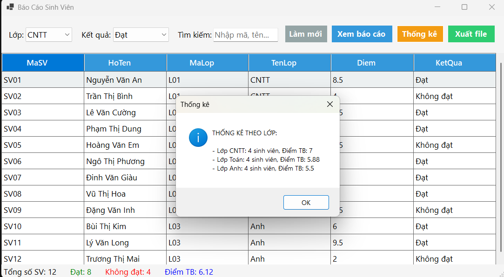
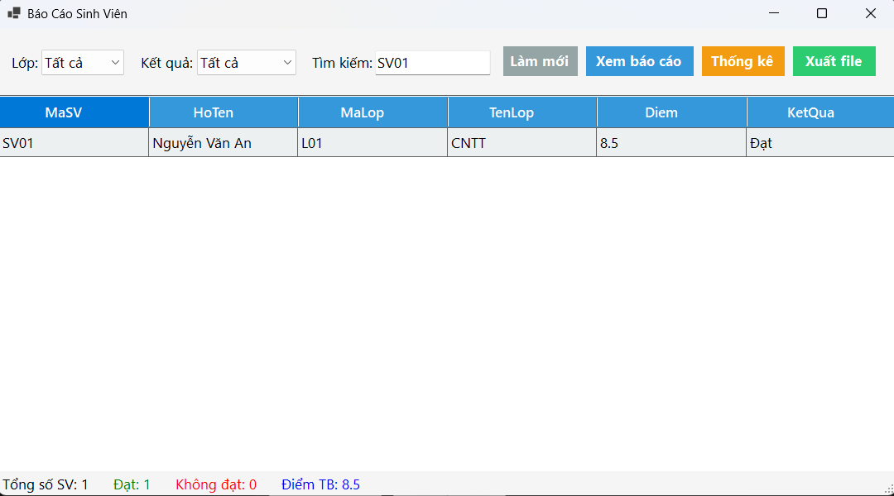
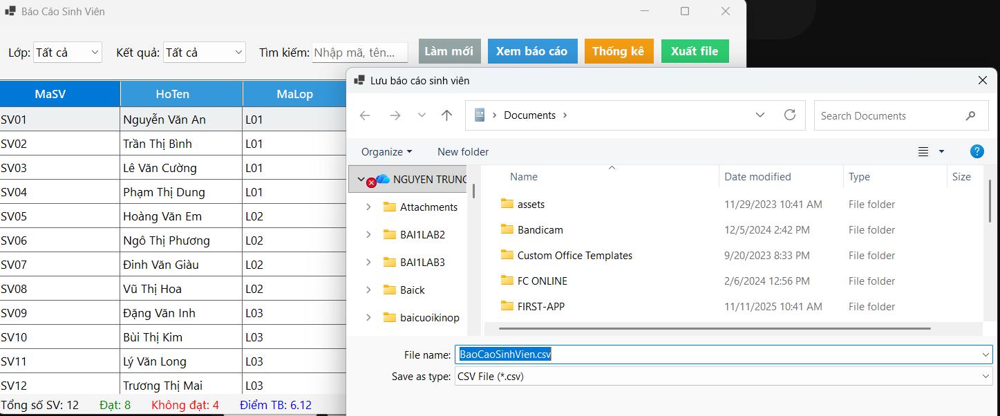

  <h3>TRƯỜNG ĐẠI HỌC SƯ PHẠM TP.HCM (HCMUE)</h3>
  <h3>KHOA CÔNG NGHỆ THÔNG TIN</h3>
  

  <h2>BÁO CÁO THỰC HÀNH LAB 13</h2>
  <h1>ỨNG DỤNG LINQ TRONG BÁO CÁO VÀ THỐNG KÊ DỮ LIỆU</h1>

**Học phần:** COMP1019 - Lập trình trên Windows  
**Ngành:** Giáo dục Tin học  
**Sinh viên thực hiện:** Nguyễn Trung Tín  
**MSSV:** 49.01.103.083  

---

## I. MỤC TIÊU BÀI THỰC HÀNH
- Nắm vững và củng cố kỹ năng truy vấn, xử lý dữ liệu bằng bộ thư viện **LINQ** (Language Integrated Query) trong C#.
- Thiết kế giao diện báo cáo, thống kê dữ liệu trực quan trên **WinForms**.
- Ứng dụng `DataGridView` để hiển thị kết quả truy vấn, kết hợp `StatusStrip` để theo dõi số liệu tổng quan theo thời gian thực.
- Xây dựng chức năng xuất dữ liệu báo cáo ra các định dạng lưu trữ cơ bản (.csv, .txt) sử dụng `StreamWriter` và `SaveFileDialog`.

## II. CÔNG NGHỆ & MÔI TRƯỜNG PHÁT TRIỂN
- **Ngôn ngữ lập trình:** C#
- **Nền tảng:** .NET / Windows Forms Application
- **Công cụ phát triển (IDE):** Visual Studio 2022
- **Thư viện chính:** `System.Linq`, `System.IO`, `System.Windows.Forms`

## III. TỔ CHỨC MÃ NGUỒN (PROJECT STRUCTURE)
Dự án được tổ chức theo mô hình phân tầng thư mục cơ bản nhằm đảm bảo tính tái sử dụng và dễ dàng bảo trì:
- 📁 **Models/**: Chứa file `SinhVien.cs` định nghĩa cấu trúc đối tượng dữ liệu.
- 📁 **Forms/**: Chứa file `FrmBaoCaoSinhVien.cs` (xử lý logic) và `FrmBaoCaoSinhVien.Designer.cs` (chứa code sinh tự động của giao diện).
- 📄 **Program.cs**: Điểm neo khởi chạy ứng dụng, đã được cấu hình trỏ về form chính trong thư mục Forms.

## IV. GIẢI PHÁP KỸ THUẬT & XỬ LÝ LÕI

### 1. Lớp đối tượng dữ liệu (Model)
- Khởi tạo class `SinhVien` với các thuộc tính cơ bản.
- Áp dụng kỹ thuật Nullable Types (`string?`) của C# để đảm bảo an toàn bộ nhớ.
- Cài đặt thuộc tính chỉ đọc `KetQua` tự động đánh giá "Đạt" hoặc "Không đạt" dựa trên điều kiện `Diem >= 5`.

### 2. Kỹ thuật truy vấn dữ liệu bằng LINQ
Tất cả các chức năng lọc và tìm kiếm đều vận hành trên đối tượng `IQueryable` thông qua thư viện LINQ:
- **Lọc và tìm kiếm đa luồng:** Kết hợp nhiều mệnh đề `.Where()` để lọc đồng thời theo Lớp, Kết quả học tập và truy vấn chuỗi tìm kiếm (Mã SV, Họ Tên).
- **Sắp xếp:** Sử dụng `.OrderByDescending()` để ưu tiên hiển thị sinh viên có điểm số cao lên đầu danh sách.
- **Thống kê:** Dùng mệnh đề `.GroupBy()` để nhóm các sinh viên theo lớp, kết hợp ẩn danh (Anonymous Type) với `.Count()` và `.Average()` để tính toán tổng số lượng và điểm trung bình cho từng lớp.

### 3. Xuất báo cáo (File I/O)
- Khai báo `SaveFileDialog` để nhận đường dẫn lưu file từ người dùng.
- Sử dụng khối lệnh `try...catch` kết hợp `using (StreamWriter...)` để ghi dữ liệu từ `DataGridView` ra định dạng Comma-Separated Values (CSV), có cơ chế bẫy lỗi để tránh crash ứng dụng khi file bị khóa.

## V. KẾT QUẢ THỰC THI (MINH CHỨNG HÌNH ẢNH)

**1. Tính năng lọc và sắp xếp dữ liệu**
Chương trình lọc thành công danh sách sinh viên thuộc lớp "CNTT" có kết quả "Đạt". Danh sách được tự động sắp xếp giảm dần theo điểm. Thanh trạng thái (StatusStrip) hiển thị đúng số liệu thống kê hiện tại (Tổng: 3, Đạt: 3).
 

**2. Tính năng tìm kiếm theo từ khóa**
Hoạt động tìm kiếm phản hồi chính xác khi nhập từ khóa "SV01". DataGridView chỉ giữ lại dữ liệu khớp với mã sinh viên hoặc họ tên chứa từ khóa.
 

**3. Tính năng thống kê (LINQ GroupBy)**
Giao diện MessageBox hiển thị báo cáo thống kê chi tiết theo từng lớp. Dữ liệu được nhóm chuẩn xác thành 3 lớp (CNTT, Toán, Anh) kèm tổng số sinh viên và điểm trung bình tương ứng của nhóm.
 

**4. Tính năng xuất file báo cáo (.csv)**
Hệ thống gọi thành công hộp thoại Windows Save File Dialog, cho phép định danh và lưu trữ file báo cáo về máy tính định dạng `.csv`.
 

## VI. KẾT LUẬN
- Hoàn thành đầy đủ 100% các tiêu chí bắt buộc của Lab 13.
- Giao diện được thiết kế phẳng (Flat Design), màu sắc hài hòa, cấu trúc code rõ ràng và đã được loại bỏ hoàn toàn các cảnh báo (Warnings) biên dịch của hệ thống.
- Bổ sung thêm tính năng "Làm mới" (Reset) giúp tối ưu hóa trải nghiệm người dùng (UX) trong quá trình thao tác với hệ thống.