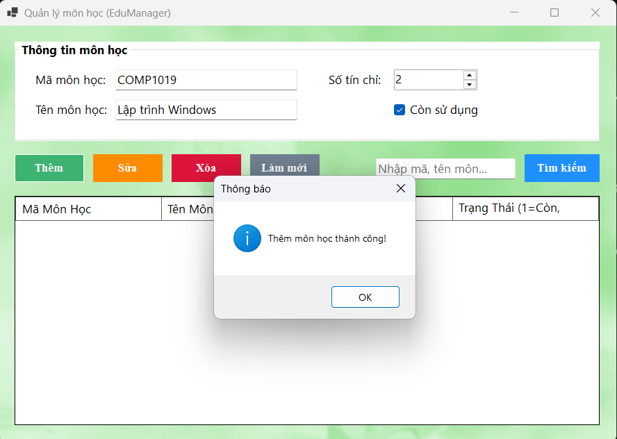
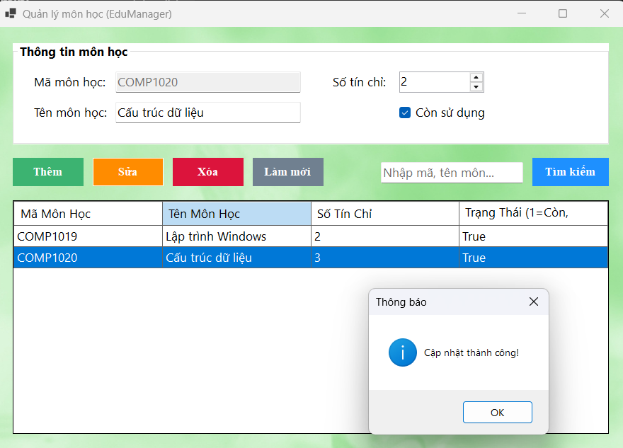
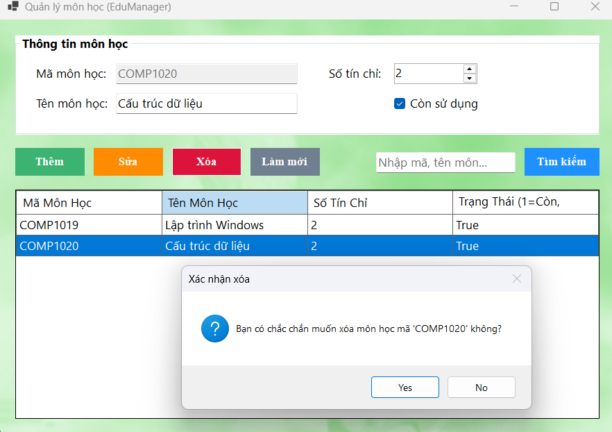
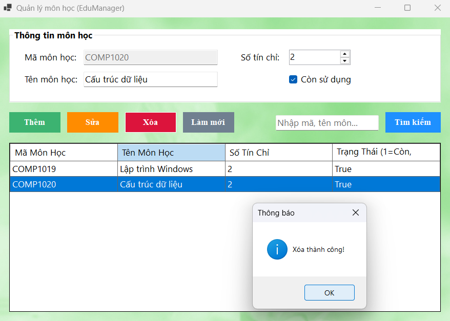
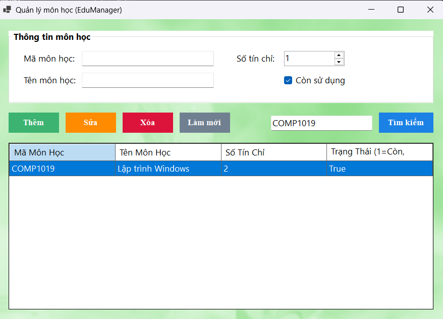

# BÁO CÁO THỰC HÀNH LAB 15: MÔ HÌNH MVP VÀ KIỂM THỬ

**Thông tin sinh viên:**
- **Họ và tên:** Nguyễn Trung Tín
- **MSSV:** 49.01.103.083
- **Môn học:** Lập trình Windows (COMP1019)
- **Module áp dụng:** Quản lý môn học (EduManager)

---

## 1. Mục tiêu bài Lab
- Hiểu và áp dụng thành công kiến trúc **MVP (Model - View - Presenter)** vào dự án WinForms C#.
- Tái cấu trúc (Refactor) module "Quản lý môn học" từ mô hình 3 lớp (3-tier) cũ sang mô hình MVP.
- Đảm bảo Form giao diện (View) không chứa code xử lý logic, các sự kiện click chỉ đơn thuần gọi phương thức từ Presenter.
- Hoàn thiện tài liệu kiểm thử (Test cases) và đóng gói dự án.

## 2. Kiến trúc hệ thống áp dụng (MVP)

Hệ thống quản lý môn học được phân rã thành các thành phần độc lập:
- **Models**: Chứa cấu trúc dữ liệu (`MonHoc.cs`) và cấu hình DbContext (`EduManagerContext.cs`) kết nối Entity Framework Core tới SQL Server.
- **Repositories**: `MonHocRepository` triển khai `IMonHocRepository`, chịu trách nhiệm thực thi các truy vấn LINQ/SQL (thêm, xóa, tìm kiếm, lấy danh sách).
- **Views**: 
  - Interface `IMonHocView` định nghĩa các thuộc tính (dữ liệu nhập từ TextBox, CheckBox) và các hành động (hiển thị danh sách, thông báo lỗi).
  - Form `FrmMonHoc` kế thừa `IMonHocView`, làm nhiệm vụ tương tác với người dùng và chuyển giao lệnh cho Presenter.
- **Presenters**: `MonHocPresenter` chứa toàn bộ business logic (kiểm tra tính hợp lệ của dữ liệu, kiểm tra trùng lặp) và điều phối giữa View - Repository.

## 3. Cấu trúc thư mục (Project Directory)

```text
Lab15
├── Models
│   ├── EduManagerContext.cs
│   └── MonHoc.cs
├── Presenters
│   └── MonHocPresenter.cs
├── Repositories
│   ├── IMonHocRepository.cs
│   └── MonHocRepository.cs
├── Views
│   ├── FrmMonHoc.cs
│   ├── FrmMonHoc.Designer.cs
│   └── IMonHocView.cs
└── Program.cs
'''text
```
### 1. Thêm mới môn học (Create)

- **Luồng xử lý:** Người dùng nhập thông tin chi tiết bao gồm Mã môn học, Tên môn học, Số tín chỉ và Trạng thái sử dụng. Khi nhấn nút **Thêm**, tầng logic (BLL) sẽ thực hiện kiểm tra tính hợp lệ của dữ liệu (Validation) để đảm bảo các trường không bị bỏ trống và Mã môn học không bị trùng lặp[cite: 18]. 
- **Kết quả:** Nếu dữ liệu hợp lệ, tầng DAL sẽ gọi Entity Framework Core để `Add` thực thể vào SQL Server, sau đó hiển thị thông báo "Thêm môn học thành công!" và tự động làm mới lưới DataGridView[cite: 18].

### 2. Cập nhật thông tin môn học (Update)

- **Luồng xử lý:** Giao diện hỗ trợ cơ chế tự động đẩy dữ liệu: khi click chọn một dòng bất kỳ trên DataGridView, thông tin sẽ được nạp ngược lên các ô nhập liệu (TextBox, NumericUpDown). Lúc này, trường "Mã môn học" sẽ bị vô hiệu hóa (Disabled) nhằm bảo vệ tính toàn vẹn của khóa chính.
- **Kết quả:** Người dùng chỉnh sửa các thông số cần thiết và nhấn **Sửa**. Tầng DAL sẽ truy xuất thực thể từ cơ sở dữ liệu, cập nhật thuộc tính và lưu lại (`SaveChanges`), trả về thông báo "Cập nhật thành công!" cho người dùng[cite: 19].

### 3. Cảnh báo xác nhận an toàn trước khi xóa

- **Luồng xử lý:** Nhằm tối ưu trải nghiệm người dùng (UX) và ngăn chặn rủi ro vô tình click nhầm gây mất mát dữ liệu, hệ thống tích hợp một lớp bảo vệ trước thao tác xóa.
- **Kết quả:** Khi nhấn nút **Xóa**, một MessageBox `Yes/No` sẽ xuất hiện, trích xuất chính xác mã môn học đang được chọn (ví dụ: *"Bạn có chắc chắn muốn xóa môn học mã 'COMP1020' không?"*) để người dùng kiểm tra lại lần cuối[cite: 20].

### 4. Xóa môn học (Delete)

- **Luồng xử lý:** Khi người dùng xác nhận "Yes" tại hộp thoại cảnh báo, mã môn học được chuyển xuống tầng DAL. Entity Framework Core sẽ tiến hành dò tìm bản ghi tương ứng trong bảng `MONHOC` và gọi phương thức `Remove`.
- **Kết quả:** Xóa dữ liệu thành công khỏi SQL Server. Hệ thống hiển thị thông báo xác nhận "Xóa thành công!" và tự động gọi lại hàm reset để tải phiên bản danh sách mới nhất lên DataGridView[cite: 21].

### 5. Tìm kiếm dữ liệu động (Search)

- **Luồng xử lý:** Tính năng tìm kiếm được tích hợp truy vấn LINQ (`.Where` kết hợp `.Contains`), cho phép người dùng tra cứu linh hoạt theo cả Mã môn học hoặc Tên môn học. 
- **Kết quả:** Khi nhập từ khóa (ví dụ: "COMP1019") và nhấn **Tìm kiếm**, danh sách trên DataGridView lập tức được lọc để chỉ hiển thị các kết quả trùng khớp[cite: 22]. Người dùng có thể nhấn nút **Làm mới** (Clear) để xóa trắng bộ lọc và hiển thị lại toàn bộ dữ liệu gốc.